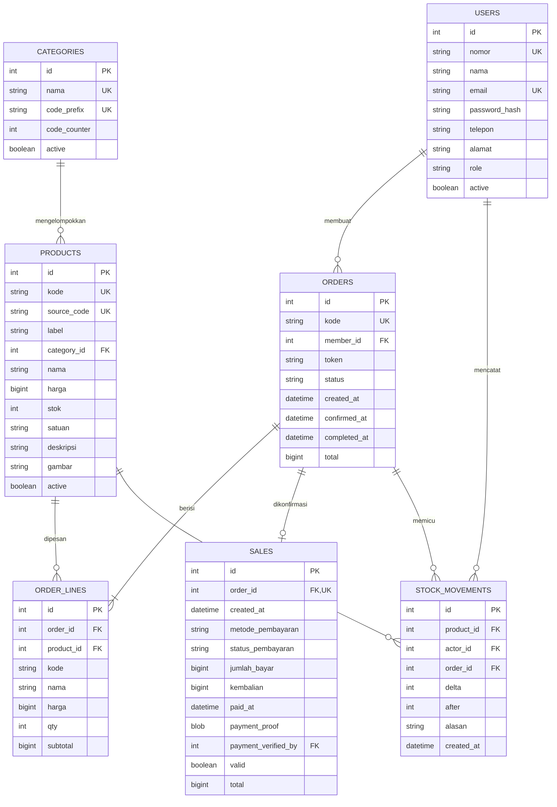
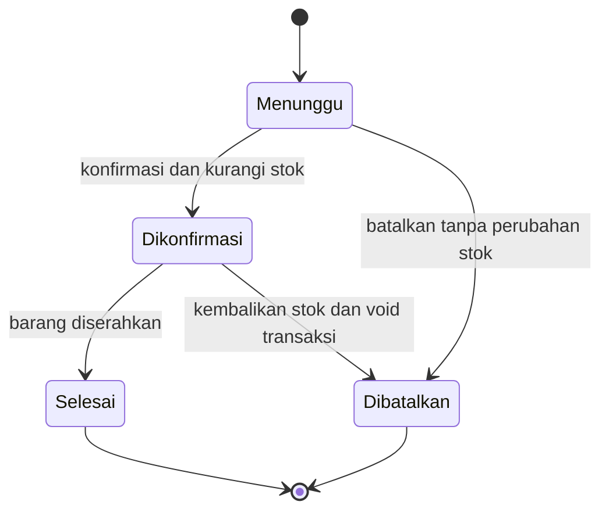
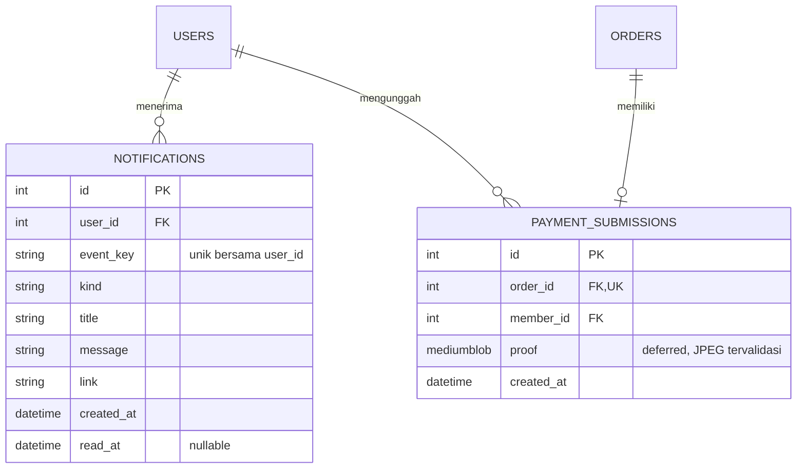

# ERD SIKOS

`ORDERS(member_id, token)` unik untuk mencegah submit pesanan yang sama dua kali.
`ORDER_LINES` menyimpan snapshot nama/kode/harga saat pemesanan agar riwayat stabil setelah produk diedit.
Datetime disimpan dalam UTC dan ditampilkan/diagregasi menggunakan Asia/Jakarta.

Status diperbolehkan:

## Penambahan notifikasi dan pengajuan bukti

Indeks inbox: user_id/read_at/id. Notifikasi disimpan per penerima dan dibuat atomik
bersama transaksi bisnis. Pengajuan bukti anggota terpisah dari bukti Sale yang sudah
terverifikasi; unggah anggota tidak mengubah status lunas atau empat status pesanan.

## Snapshot HPP

PRODUCTS.hpp dan ORDER_LINES.hpp berupa BIGINT nullable. PRODUCTS.hpp adalah HPP per unit
yang diisi admin; ORDER_LINES.hpp disalin dari produk saat konfirmasi pertama di dalam lock
produk/transaksi yang sama. Nilai null berbeda dari nol. Snapshot harga jual saat pesan tetap.
Tidak ada perubahan tabel Sale untuk perhitungan ini; agregasi memakai baris pesanan yang
terhubung dengan Sale.valid. Migrasi: migrate-hpp, additive dan tanpa backfill.

## Markup kategori

CATEGORIES.markup_percent: NUMERIC(5,2), default kategori kustom 15, validasi 0–100.
Harga produk dihitung dari HPP positif dan persentase dengan pembulatan ke atas Rp100;
OrderLine.harga tetap snapshot saat pesan dan OrderLine.hpp snapshot saat konfirmasi.
Migrasi migrate-pricing hanya menambah/set default kolom baru, tidak mereset nilai admin
atau mengubah harga, stok dan snapshot lama. Penyimpanan kategori/produk memakai urutan
lock Category lalu Product untuk repricing yang konsisten.
