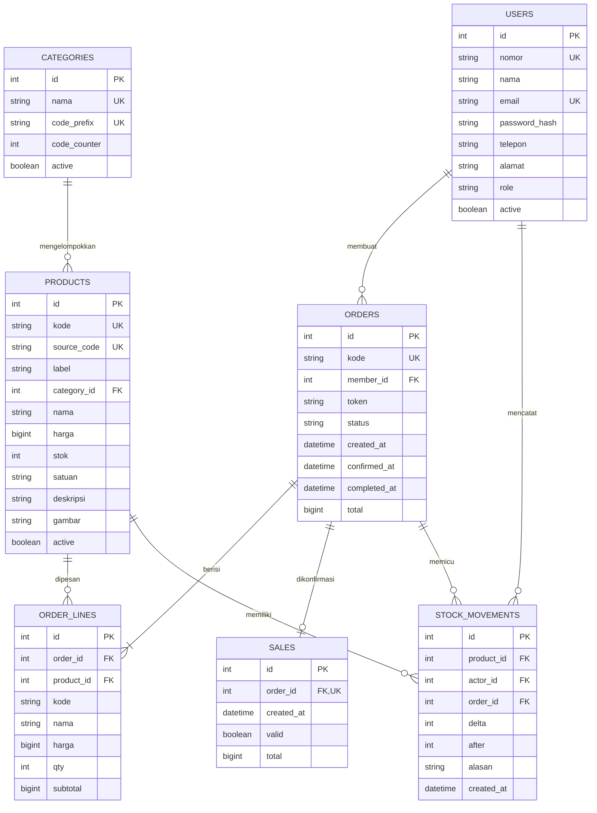
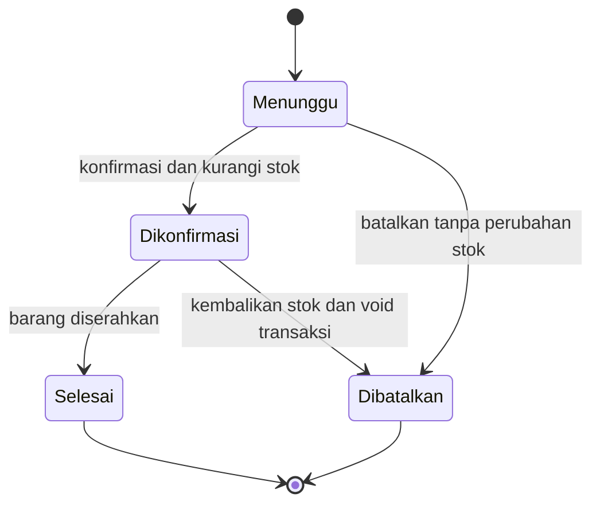

# ERD SIKOS

`ORDERS(member_id, token)` unik untuk mencegah submit pesanan yang sama dua kali.
`ORDER_LINES` menyimpan snapshot nama/kode/harga saat pemesanan agar riwayat stabil setelah produk diedit.
Datetime disimpan dalam UTC dan ditampilkan/diagregasi menggunakan Asia/Jakarta.

Status diperbolehkan:

